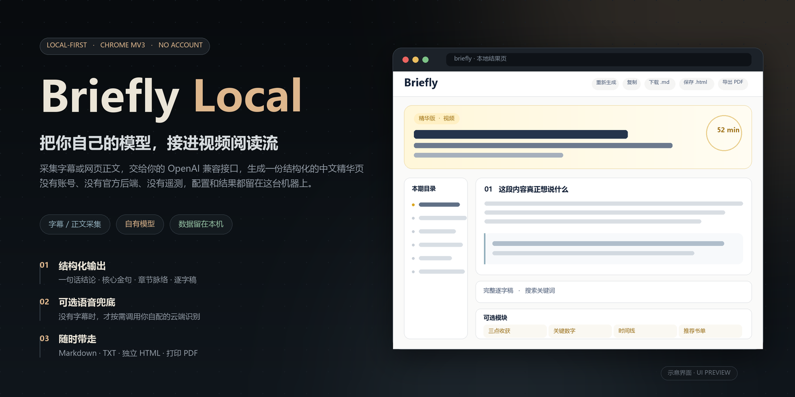
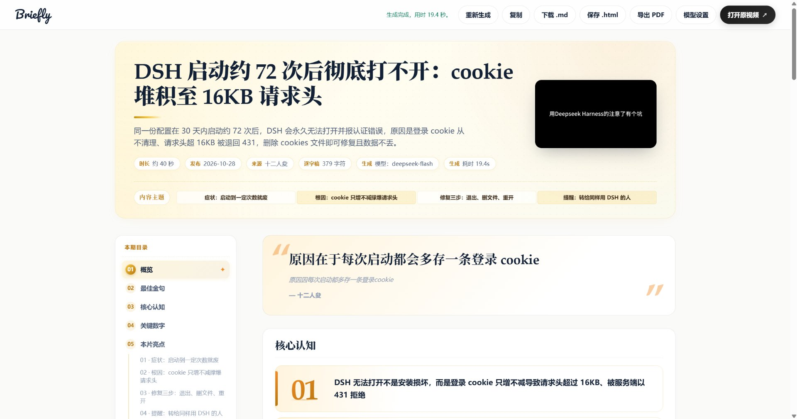
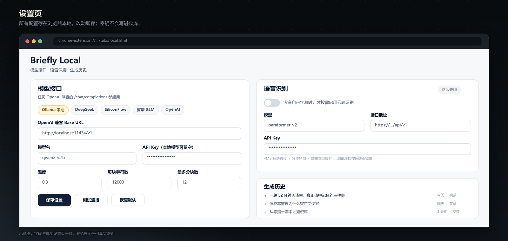
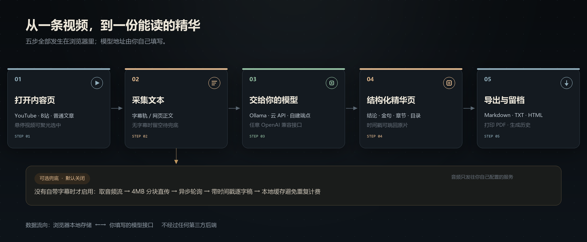

<div align="center">
  
</div>

# Briefly Local

> 本地优先的视频 / 网页精华总结扩展。采集字幕或正文 → 交给**你自己的模型** → 生成一份结构化的中文精华页。

不需要账号，不依赖任何托管后端，模型地址由你自己填写；配置、采集文本和结果都留在这台机器的浏览器里。

[界面](#界面预览) · [工作流程](#工作流程) · [安装](#安装) · [配置模型](#配置模型) · [使用](#使用) · [无字幕兜底](#没有字幕时可选云端语音识别) · [隐私](#隐私与数据) · [常见问题](#常见问题)

---

## 它能做什么

- **模型自己选**：Ollama、DeepSeek、SiliconFlow、智谱 GLM、OpenAI，或任何 OpenAI 兼容的 `/chat/completions` 端点。设置页内置预设，一键切换并测试连接。
- **结构化输出**：不是一段散装 Markdown，而是按固定 JSON 结构渲染的页面 —— 一句话结论、核心金句（原文 + 中文意译）、3–6 段章节脉络、原文金句与术语就地标注、时间戳、完整逐字稿。
- **按需出现的模块**：三点收获、关键数字、时间线、前后对比、推荐书单、趣闻、故事 —— 素材里没有的内容不会硬凑。
- **读起来顺手**：视频页悬停聚光选中、生成中进度与骨架屏、点击时间戳跳回原片、"打开原视频" 一键回跳、生成完成可开通知提醒、逐字稿关键词搜索。
- **随时带走**：复制 Markdown、下载 `.md` / `.txt`、保存**内嵌样式的独立 HTML**、打印 / 导出 PDF，生成历史随时找回。
- **可选语音兜底**：视频没有自带字幕时，才按需调用你自配的云端语音识别，产出带时间戳的逐字稿，再走同一套生成流程。

> 结果页是「结构化数据 + 固定模板」，所以模型决定内容质量，版式不会跑偏。输出结构的提示词可以在设置页直接改。

---

## 界面预览

### 结果页

实际生成出来的页面长这样：



### 设置页



> 结果页为真实生成页面的截图；设置页为界面示意图，字段与模块和真实页面一致。

---

## 工作流程



采集到的文本会在浏览器里切块、逐段交给模型，再合并成一份结果；整个过程不经过第三方服务端。若采集结果没有字幕，可选分支才会启用语音识别。

---

## 安装

1. 下载源码，或执行 `git clone https://github.com/SharpBio/briefly-local.git`
2. 打开 `chrome://extensions`（Edge 为 `edge://extensions`），开启右上角 **开发者模式**
3. 点击 **加载已解压的扩展程序**，选择含 `manifest.json` 的 `briefly-local/` 目录
4. 首次安装会自动打开设置页；之后可点扩展弹窗右上角的齿轮图标进入

> 不需要 `npm install`，也不需要打包，源码即扩展。Manifest V3，适用于 Chrome / Edge 等 Chromium 内核浏览器。

---

## 配置模型

设置页「模型接口」卡片：

| 字段 | 默认值 | 说明 |
| --- | --- | --- |
| OpenAI 兼容 Base URL | `http://localhost:11434/v1` | 填到 `/v1` 即可，内部自动补 `/chat/completions`；也可直接填完整地址 |
| 模型名 | `qwen2.5:7b` | 与服务端实际模型名一致 |
| API Key | 空 | 本地模型留空，云 API 填自己的 |
| 温度 | `0.3` | 越低越稳定 |
| 每块字符数 | `12000` | 长文本切块大小 |
| 最多分块数 | `12` | 超长内容的上限，避免一次跑太久 |
| 输出结构提示词 | 内置中文 schema | 直接改字段就能换版式 / 换文风 |

内置预设：

| 预设 | Base URL | 模型 |
| --- | --- | --- |
| Ollama 本地 | `http://localhost:11434/v1` | `qwen2.5:7b` |
| DeepSeek | `https://api.deepseek.com` | `deepseek-chat` |
| SiliconFlow | `https://api.siliconflow.cn/v1` | `Qwen/Qwen2.5-7B-Instruct` |
| 智谱 GLM | `https://open.bigmodel.cn/api/paas/v4` | `glm-4-flash` |
| OpenAI | `https://api.openai.com/v1` | `gpt-4o-mini` |

填好后点 **保存设置**，再点 **测试连接** 确认可用。

纯本地跑法：

```bash
ollama serve
ollama pull qwen2.5:7b
```

如果本地模型返回 403 或 CORS 错误，给 Ollama 设置 `OLLAMA_ORIGINS=*` 后重启服务。

---

## 使用

1. 打开 YouTube / B站视频页，或普通文章页
2. 点扩展图标（或视频页的浮层）→ **生成精华版**
3. 扩展采集字幕 / 正文，打开本地结果页并显示生成进度
4. 在结果页阅读、搜索逐字稿、点时间戳回看、导出留档

**结果页顶栏**：重新生成 · 复制 · 下载 `.md` · 保存 `.html` · 导出 PDF · 模型设置 · **打开原视频 ↗**

> - 生成时请**保持原视频标签页打开**：字幕轨需要在原页面里重新读取。
> - 按住 `Shift` 点「重新生成」可强制重跑语音识别（清掉识别缓存）。
> - 结果默认不落磁盘，只存在浏览器本地存储里；想长期留档请用「保存 .html」或「下载 .md」。

---

## 没有字幕时：可选云端语音识别

**默认关闭**，且只在采集结果没有字幕时才会触发。需要在设置页「语音识别」卡片里启用、填好接口地址和密钥。

| 字段 | 默认值 |
| --- | --- |
| 启用 | `false` |
| 模型 | `paraformer-v2` |
| 接口地址 | `https://dashscope.aliyuncs.com/api/v1` |
| 轮询间隔 / 最长等待 / 音频上限 | `5s` / `1800s` / `250MB` |

处理链路：

```
取原页面音频流 → 4MB 分块 Blob → 获取上传凭证 → 表单直传
→ 提交异步转写任务 → 轮询任务状态 → 下载结果
→ [mm:ss] 文本逐字稿 → 写入本地缓存 → 走原有模型生成流程
```

- 音频只发往**你自己填写**的服务；不启用就完全不会上传
- 识别结果按条目缓存在本地，重新生成不会重复提交计费；任务提交后中断会接着轮询
- 云端识别会产生费用，请自行确认额度与计费规则
- 已知限制：B站可直接取音频流；若音频流被签名保护且没有字幕轨，目前仍不支持

---

## 隐私与数据

| 数据 | 位置 |
| --- | --- |
| 模型配置、API Key | `chrome.storage.local` |
| 采集的字幕 / 正文、生成结果、生成历史、语音识别缓存 | `chrome.storage.local` |
| 发出的网络请求 | 你填写的模型接口；启用语音识别时额外发往你填写的识别服务 |
| 账号、遥测、托管后端 | 无 |

`manifest.json` 里的 `host_permissions` 是 `<all_urls>`，目的是让任意模型地址和视频站点可连；想更严格可以自行收窄。清理数据：设置页「清空历史」，或直接卸载扩展。

---

## 目录结构

```
briefly-local/
├── manifest.json              # MV3 配置
├── popup.html / popup.js      # 扩展弹窗
├── capture.js                 # 字幕 / 正文采集
├── theater.js                 # 视频页悬停聚光选中
├── notice.js                  # 页面内提示与浮层
├── static/background/         # service worker：本地请求拦截与调度
├── tabs/
│   ├── local.html/js/css      # 设置页
│   ├── local-core.js          # 配置、模型客户端、结果渲染
│   ├── asr-core.js            # 可选语音识别链路
│   ├── result.html/js         # 结果页
│   ├── result-style.css       # 结果页样式
│   └── loading.css            # 生成中进度与骨架屏
├── docs/images/               # 本文档配图
└── _locales/ icons
```

---

## 常见问题

**提示「没有可用文本」**：确认原视频标签页仍打开、视频确实有字幕；或到设置页启用语音识别。

**测试连接失败**：依次检查服务是否启动、地址与端口、Key 与额度、本地模型的跨域设置，以及 `host_permissions` 是否覆盖该域名。

**输出样式不理想**：在设置页调整输出结构提示词；建议使用能稳定返回 JSON 的模型，长内容可调小每块字符数。

**生成太慢**：减小「每块字符数」/「最多分块数」，或换更快的模型。纯本地推理速度取决于显卡与模型规模。

**结果保存在哪**：默认在 `chrome.storage.local`，扩展页卸载即清；导出后才落磁盘。

---

## 说明

- 本仓库暂未指定开源许可证，使用前请先确认授权方式。
- 除结果页截图外，其余配图为界面示意图，仅用于说明版式与流程。
